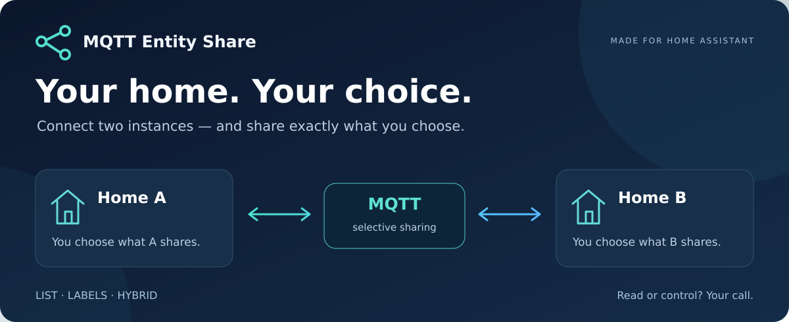
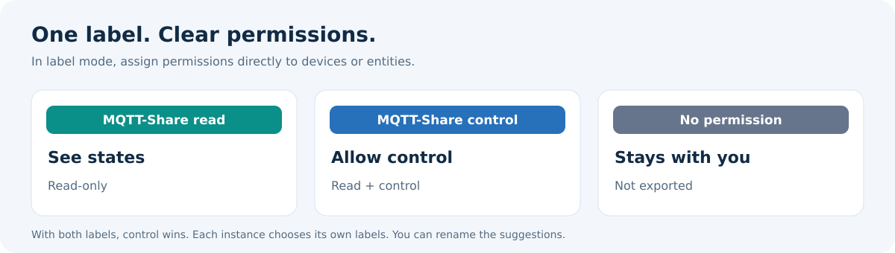

<div align="center">



**Connect two Home Assistant instances. Share selectively. Stay in control.**

[](#installation)
[](#project-status)
[](#requirements)
[](LICENSE)

[🚀 Installation](#installation) · [🏷️ Permissions](#permissions) · [🔌 Connection](#connection) · [💬 FAQ](#faq) · [🇩🇪 Deutsch](docs/README.de.md)

**🇬🇧 English · [🇩🇪 Vollständige deutsche Anleitung](docs/README.de.md)**

</div>

---

## 🏡 Connected homes. Independent choices.

Want to use selected lights, sensors or switches in another Home Assistant instance? **MQTT Entity Share** lets the sending instance choose exactly which entities to share — and whether the other side can only read their states or also control them.

Let another household see a sensor or operate a shared light. Sharing can work in **both directions**, with independent permissions for each home.

### ✨ What you get

| | Feature |
| :---: | :--- |
| 🎯 | **Select what matters:** use a fixed list, labels or a combination of both. |
| 🏷️ | **Label and share:** assign labels to individual entities or whole devices. |
| 🔐 | **Choose permissions:** read-only access or additional control. |
| 🧭 | **Keep selection manageable:** filter by area, type and name; collect entities in several rounds. |
| 🔄 | **Keep up with changes:** label assignments are reevaluated automatically. |
| 🌉 | **Keep your existing MQTT setup:** optionally connect a remote sharing broker over secure WebSockets. |
| 🛑 | **Avoid loops:** received MQTT Share entities are excluded from export. |
| 🌍 | **Use your language:** English and German setup screens, with English as the fallback. |

<a id="permissions"></a>

## 🏷️ You decide what gets shared



These names are suggestions. Select existing labels or enter your own names during setup. New labels are created only when you confirm the final save.

> 💡 **Device or entity?** A device label applies to its supported entities, excluding disabled or hidden entities. To share just a light, label the light entity itself. This keeps additional settings and sensors out of the share.

### Three ways to build your selection

| Mode | How it works | Best for… |
| :--- | :--- | :--- |
| 📋 **List** | Select entities with checkboxes and grant control individually. | a fixed, manageable selection |
| 🏷️ **Labels** | Derive sharing and control permissions from your labels. | managing shares directly on devices and entities |
| 🧩 **Hybrid** | Combine labels with manual permissions and exclusions. | automatic selection with specific exceptions |

In hybrid mode, **exclusions override manual permissions, which override labels**. If both labels apply, the control label wins. Each instance can use its own labels.

<a id="installation"></a>

## 🚀 Install with HACS

**Add this project as a custom repository:**

1. Open **HACS → ⋮ → Custom repositories**.
2. Enter this URL:

   ```text
   https://github.com/kevlacross/mqtt-entity-share
   ```

3. Choose **Integration** as the type and add the repository.
4. Download **MQTT Entity Share** and restart Home Assistant.
5. Open **Settings → Devices & services → Add integration → MQTT Entity Share**.

> ℹ️ This project can be installed through HACS as a custom repository. It is currently **not included in the default HACS catalog**.

### 🪄 Your first setup

1. Choose a dedicated MQTT topic root and discovery prefix for your shares.
2. Enable the remote WebSocket bridge if needed and enter its connection details.
3. Choose **List**, **Labels** or **Hybrid**.
4. Review the effective read and control permissions, then save.
5. In label mode, assign your labels to the devices or entities you want to share. 🎉

**On the receiving instance, shared devices and entities appear under:**

**Settings → Devices & services → MQTT**

MQTT Entity Share manages sharing and the connection; the built-in MQTT integration creates the received entities.

<a id="requirements"></a>

## 🧰 What you need

- **Home Assistant 2026.10 or newer**; tested with 2026.10.4 so far.
- An existing **MQTT integration** on the participating instances.
- An MQTT broker and correctly configured connections between the locations.
- For remote access: authenticated accounts, encrypted transport and appropriately scoped topic permissions (ACLs).

<a id="connection"></a>

## 🌉 Two homes, a selective connection

The integration uses your existing MQTT connection. It does not install a broker automatically.

During initial setup, you can optionally enable a **secure WebSocket bridge** on the remote side. It connects the local MQTT broker to a remote sharing broker while keeping the existing MQTT integration in place.

| Setting | Purpose |
| :--- | :--- |
| **Host & credentials** | Hostname, username and password of the sharing broker |
| **TLS port** | Defaults to `443`; certificate verification remains enabled |
| **WebSocket path** | `/mqtt` |
| **Peer topic root & source ID** | Identify which source to receive through the bridge |
| **Local discovery prefix** | Must match the existing MQTT discovery prefix on this instance |

For **A ↔ B**, install the integration on both instances and use different topic roots, such as `ha_share/source_a` and `ha_share/source_b`. Broker bridges, discovery routing and ACLs must be configured for both directions. Installing the integration alone does not establish that connection.

<details>
<summary><strong>🔎 Discovery and existing MQTT devices</strong></summary>

The receiving instance needs the shared discovery configurations and state topics. A dedicated sharing prefix separates exports from local MQTT discovery. The WebSocket bridge maps incoming discovery topics to the configured local prefix; an external broker bridge needs equivalent routing.

Before changing the discovery prefix of an existing MQTT integration, check the effects on its current devices.

</details>

<a id="faq"></a>

## 💬 Frequently asked questions

<details>
<summary><strong>Who decides what is shared?</strong></summary>

The sending instance. A decides what B can receive from A. B independently decides what A can receive from B.

</details>

<details>
<summary><strong>Can the receiver control a read-only share?</strong></summary>

The sending instance checks every incoming command against its current permissions and rejects commands for read-only shares. The received MQTT entity may still display controls; their visibility does not grant control permission. Retained control commands are also rejected.

</details>

<details>
<summary><strong>Why do I receive more entities than the number of devices I labeled?</strong></summary>

A device may contain several supported entities: a light, settings and sensors, for example. A device label includes these entities. Label individual entities for finer selection. Disabled and hidden entities are excluded.

</details>

<details>
<summary><strong>Why does a new entity initially show “unknown”?</strong></summary>

Discovery can arrive before the first state value. The next update or periodic refresh — normally within about five minutes — supplies the state, provided the source is reachable and has a valid state.

</details>

<details>
<summary><strong>Do both instances need the same label names?</strong></summary>

No. Each instance chooses its own labels. Matching names can be convenient, but are not required. The control label takes precedence over the read-only label. Changing the interface language does not rename existing labels, entities or shares.

</details>

<details>
<summary><strong>Which interface languages are supported?</strong></summary>

English and German. Home Assistant selects the interface translations; other languages fall back to English. The selection values, entity IDs and permissions stay the same across languages. Entity and area names remain the names you chose in Home Assistant.

</details>

<a id="project-status"></a>

## 🧪 Project status

**Early test release · currently 0.5.0**

Selection, permission checks and transport in both directions have been tested. Not every supported device type and command has been tested end to end. One integration entry per instance is supported.

**New in 0.5.0:** English and German setup screens, including selector options, entity-type filters and help text. Existing labels and shares are preserved. The fix for rapid consecutive label edits from 0.4.1 is included.

## 🤝 Get involved

Found a bug or have an idea for the next improvement?

[🐛 Report a bug](https://github.com/kevlacross/mqtt-entity-share/issues/new) · [💡 Ideas and questions](https://github.com/kevlacross/mqtt-entity-share/issues)

Include your Home Assistant version, sharing mode and expected behavior. Remove passwords, tokens and private connection details from logs and screenshots.

## 💙 Thanks to the original project

MQTT Entity Share is based on [MQTT DiscoveryStream Alt](https://github.com/RogerSelwyn/mqtt_discoverystream_ha) by Roger Selwyn. The original **MIT license and copyright notices** are preserved.

This project adds the sharing interface, manual selection, label and hybrid rules, command permission checks and an optional WebSocket bridge. Please report issues with this variant in this repository.

---

<div align="center">

**🏡 Stay connected. Choose what you share.**

[Back to top ↑](#)

</div>
