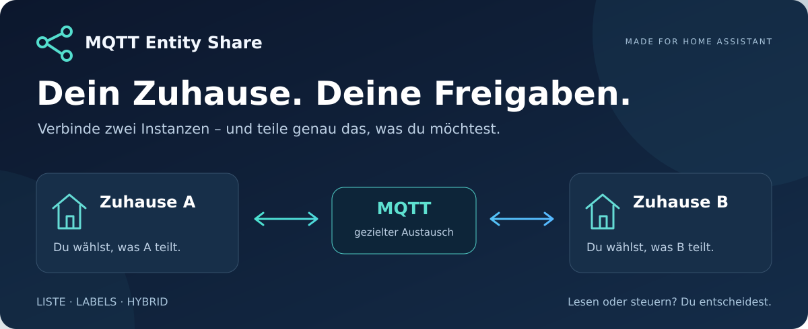
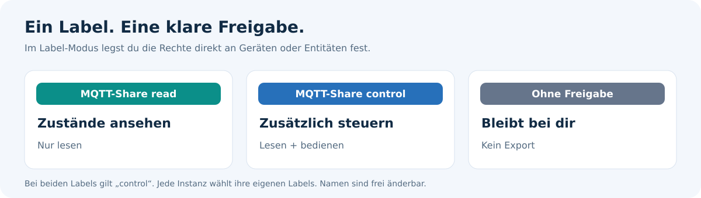

<div align="center">



**Zwei Home-Assistant-Instanzen verbinden. Gezielt teilen. Selbst entscheiden.**

[](#installation)
[](#projektstatus)
[](#voraussetzungen)
[](../LICENSE)

[🚀 Installation](#installation) · [🏷️ Freigaben](#freigaben) · [🔌 Verbindung](#verbindung) · [💬 Fragen](#fragen) · [🇬🇧 English](../README.md)

</div>

---

## 🏡 Dein Smart Home darf verbunden sein – und trotzdem deins bleiben

Du möchtest ausgewählte Lampen, Sensoren oder Schalter in einer zweiten Home-Assistant-Instanz nutzen? **MQTT Entity Share** hilft dir dabei: Du bestimmst auf der sendenden Instanz, welche Entitäten geteilt werden und ob die Gegenstelle nur mitlesen oder auch steuern darf.

Ideal, wenn zum Beispiel ein zweiter Haushalt einen Sensor sehen oder eine freigegebene Lampe bedienen soll. Der Austausch kann in **beide Richtungen** laufen – mit getrennten Freigaben für jedes Zuhause.

### ✨ Das steckt drin

| | Funktion |
| :---: | :--- |
| 🎯 | **Gezielt auswählen:** feste Liste, Labels oder beides kombinieren. |
| 🏷️ | **Einfach markieren:** Labels an einzelnen Entitäten oder ganzen Geräten vergeben. |
| 🔐 | **Rechte selbst vergeben:** nur lesen oder zusätzlich Steuerbefehle erlauben. |
| 🧭 | **Den Überblick behalten:** nach Raum, Typ und Name filtern; Auswahl in mehreren Runden sammeln. |
| 🔄 | **Automatisch nachziehen:** geänderte Label-Zuweisungen werden neu ausgewertet. |
| 🌉 | **Bestehendes MQTT behalten:** optionale WebSocket-Brücke für einen entfernten Freigabe-Broker. |
| 🛑 | **Schleifen vermeiden:** empfangene MQTT-Share-Entitäten werden nicht erneut exportiert. |

<a id="freigaben"></a>

## 🏷️ So bestimmst du, was geteilt wird



Die Namen sind Vorschläge. Du kannst im Setup vorhandene Labels auswählen oder eigene Namen angeben. Neue Labels werden erst beim abschließenden Speichern angelegt.

> 💡 **Gerät oder einzelne Entität?** Ein Label am Gerät gilt für dessen unterstützte, nicht deaktivierte oder ausgeblendete Entitäten. Möchtest du nur die Lampe teilen, vergib das Label direkt an der Licht-Entität. So bleiben zusätzliche Einstellungen und Sensoren außen vor.

### Drei Modi – passend zu deinem Alltag

| Modus | So funktioniert’s | Gut für … |
| :--- | :--- | :--- |
| 📋 **Liste** | Entitäten per Häkchen auswählen und Steuerrechte je Entität vergeben. | eine feste, überschaubare Freigabe |
| 🏷️ **Labels** | Freigaben automatisch aus deinen Lese- und Steuer-Labels ableiten. | Änderungen direkt an Geräten und Entitäten |
| 🧩 **Hybrid** | Labels mit manuellen Rechten und Ausschlüssen kombinieren. | automatische Auswahl mit gezielten Ausnahmen |

Im Hybrid-Modus gilt: **Ausschluss → manuelle Rechte → Labels**. Sind beide Labels gesetzt, gilt das Steuer-Label. Jede Instanz kann eigene Labels verwenden.

<a id="installation"></a>

## 🚀 Installation mit HACS

**Als benutzerdefiniertes Repository hinzufügen:**

1. Öffne **HACS → ⋮ → Benutzerdefinierte Repositories**.
2. Trage diese Adresse ein:

   ```text
   https://github.com/kevlacross/mqtt-entity-share
   ```

3. Wähle als Typ **Integration** und füge das Repository hinzu.
4. Lade **MQTT Entity Share** herunter und starte Home Assistant neu.
5. Öffne **Einstellungen → Geräte & Dienste → Integration hinzufügen → MQTT Entity Share**.

> ℹ️ Das Repository ist über HACS installierbar. Es ist derzeit **kein Eintrag im allgemeinen HACS-Standardkatalog**.

### 🪄 Dein erster Durchlauf

1. Lege einen eigenen MQTT-Themenpfad und Discovery-Präfix für deine Freigaben fest.
2. Aktiviere bei Bedarf die entfernte WebSocket-Brücke und trage die Verbindungsdaten ein.
3. Wähle **Liste**, **Labels** oder **Hybrid**.
4. Prüfe die Übersicht mit den wirksamen Lese- und Steuerrechten und speichere die Freigabe.
5. Im Label-Modus: Vergib deine Labels an den gewünschten Geräten oder Entitäten. 🎉

**Auf der Gegenseite findest du empfangene Geräte und Entitäten unter:**

**Einstellungen → Geräte & Dienste → MQTT**

Unsere Integration verwaltet Freigaben und Verbindung; die normale MQTT-Integration legt die empfangenen Entitäten an.

<a id="voraussetzungen"></a>

## 🧰 Was du brauchst

- **Home Assistant ab 2026.10**; bisher getestet mit 2026.10.4.
- Eine bereits eingerichtete **MQTT-Integration** auf den beteiligten Instanzen.
- Einen MQTT-Broker und passend eingerichtete Verbindungen zwischen den Standorten.
- Für entfernten Zugriff: authentifizierte Zugänge, verschlüsselte Übertragung und passende Topic-Rechte (ACLs).

<a id="verbindung"></a>

## 🌉 Zwei Zuhause, eine gezielte Verbindung

Die Integration verwendet deine vorhandene MQTT-Verbindung. Ein Broker wird dadurch nicht automatisch installiert.

Für die Gegenseite kannst du beim ersten Setup optional die **sichere WebSocket-Brücke** einschalten. Sie verbindet den lokalen MQTT-Broker mit einem entfernten Freigabe-Broker, ohne die bestehende MQTT-Integration umzuschalten.

| Einstellung | Bedeutung |
| :--- | :--- |
| **Host & Zugang** | Hostname, Benutzername und Passwort des Freigabe-Brokers |
| **TLS-Port** | Standard: `443`; die Zertifikatsprüfung bleibt aktiv |
| **WebSocket-Pfad** | `/mqtt` |
| **Themenpfad & Quell-ID der Gegenstelle** | Bestimmen, welche Quelle über die Brücke empfangen wird |
| **Lokaler Discovery-Präfix** | Muss zum bestehenden MQTT-Discovery deiner Instanz passen |

Für **A ↔ B** installierst du die Integration auf beiden Seiten und verwendest unterschiedliche Themenpfade, zum Beispiel `ha_share/source_a` und `ha_share/source_b`. Broker-Brücken, Discovery-Routing und ACLs müssen für beide Richtungen passen. Die Installation allein stellt diese Verbindung noch nicht her.

<details>
<summary><strong>🔎 Details zu Discovery und bestehenden MQTT-Geräten</strong></summary>

Die Empfängerseite muss die freigegebenen Discovery-Konfigurationen und Zustände erhalten. Ein eigener Freigabe-Präfix trennt den Export vom lokalen MQTT-Discovery. Die WebSocket-Brücke setzt empfangene Discovery-Topics auf den angegebenen lokalen Präfix um; eine externe Broker-Brücke benötigt ein entsprechendes Routing.

Ändere den Discovery-Präfix einer bereits verwendeten MQTT-Integration erst, nachdem du die Auswirkungen auf vorhandene Geräte geprüft hast.

</details>

<a id="fragen"></a>

## 💬 Häufige Fragen

<details>
<summary><strong>Wer entscheidet, was geteilt wird?</strong></summary>

Die sendende Instanz. A legt fest, was B von A erhält. B legt unabhängig davon fest, was A von B erhält.

</details>

<details>
<summary><strong>Kann die Gegenseite eine reine Lese-Freigabe trotzdem steuern?</strong></summary>

Die sendende Instanz prüft jeden eingehenden Befehl gegen ihre aktuellen Rechte. Bei einer reinen Lese-Freigabe wird er zurückgewiesen. Die empfangene MQTT-Entität kann trotzdem Bedienelemente anzeigen; deren Sichtbarkeit erteilt keine Steuerberechtigung. Retained-Steuerbefehle werden ebenfalls abgewiesen.

</details>

<details>
<summary><strong>Warum erscheinen mehr Entitäten als markierte Geräte?</strong></summary>

Ein Gerät kann mehrere unterstützte Entitäten besitzen: zum Beispiel eine Lampe, Einstellungen und Sensoren. Ein Geräte-Label bezieht diese Entitäten mit ein. Setze das Label an einzelnen Entitäten, wenn du feiner auswählen möchtest. Deaktivierte und ausgeblendete Entitäten werden ausgeschlossen.

</details>

<details>
<summary><strong>Warum ist eine neue Entität zunächst „unbekannt“?</strong></summary>

Die Geräteerkennung kann vor dem ersten Zustandswert ankommen. Beim nächsten Update oder der regelmäßigen Aktualisierung – normalerweise spätestens nach etwa fünf Minuten – wird der Zustand nachgeliefert, sofern die Quelle erreichbar ist und einen gültigen Zustand hat.

</details>

<details>
<summary><strong>Brauche ich für beide Seiten dieselben Label-Namen?</strong></summary>

Nein. Du wählst die Labels pro Instanz. Gleiche Namen sind praktisch, aber keine Voraussetzung. Ein Label mit Steuerrechten hat Vorrang vor dem Lese-Label.

</details>

<a id="projektstatus"></a>

## 🧪 Projektstatus

**Frühe Testversion · aktuell 0.5.0**

Die Auswahl- und Rechteprüfung sowie der Transport in beide Richtungen wurden getestet. Noch nicht jede unterstützte Geräteart und jeder Befehl ist Ende zu Ende geprüft. Pro Instanz wird ein Integrationseintrag unterstützt. Die Einrichtung ist auf Deutsch und Englisch verfügbar; andere Sprachen verwenden den englischen Fallback.

**Neu in 0.5.0:** Deutsche und englische Oberfläche mit übersetzten Auswahlfeldern, Filtertypen und Hilfetexten. Bestehende Labels, Freigaben und Entitätsnamen bleiben unverändert. Die Korrektur für schnelle Label-Änderungen aus 0.4.1 ist enthalten.

## 🤝 Mitmachen & Rückmeldung

Du hast einen Fehler entdeckt oder eine Idee für die nächste Verbesserung?

[🐛 Fehler melden](https://github.com/kevlacross/mqtt-entity-share/issues/new) · [💡 Ideen und Fragen](https://github.com/kevlacross/mqtt-entity-share/issues)

Bitte beschreibe deine Home-Assistant-Version, den gewählten Modus und das erwartete Verhalten. Entferne Passwörter, Tokens und private Verbindungsdaten aus Protokollen und Screenshots.

## 💙 Danke an das ursprüngliche Projekt

MQTT Entity Share basiert auf [MQTT DiscoveryStream Alt](https://github.com/RogerSelwyn/mqtt_discoverystream_ha) von Roger Selwyn. Die ursprüngliche **MIT-Lizenz und Copyright-Hinweise** bleiben erhalten.

Dieses Projekt ergänzt die Freigabe-Oberfläche, manuelle Auswahl, Label- und Hybrid-Regeln, die Prüfung von Steuerrechten und eine optionale WebSocket-Brücke. Rückmeldungen zu dieser Variante bitte hier im Repository melden.

---

<div align="center">

**🏡 Verbunden bleiben. Freigaben bewusst wählen.**

[Nach oben ↑](#)

</div>
